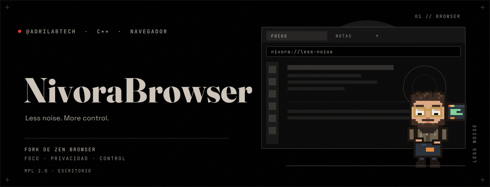
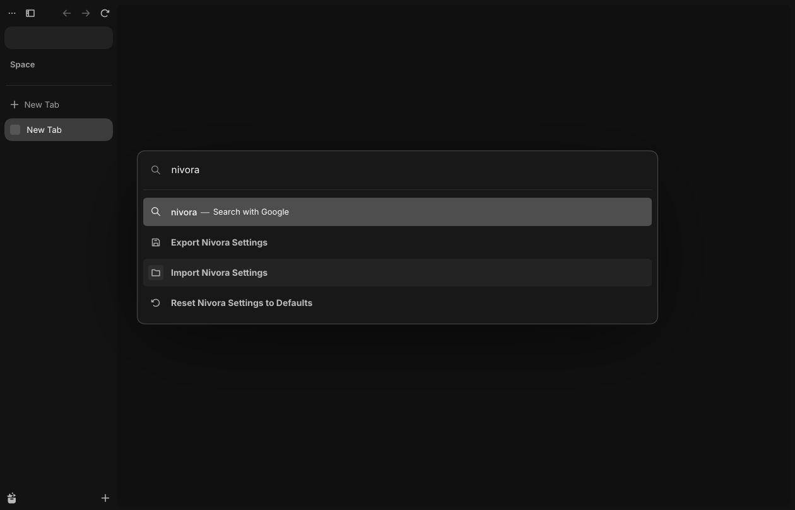
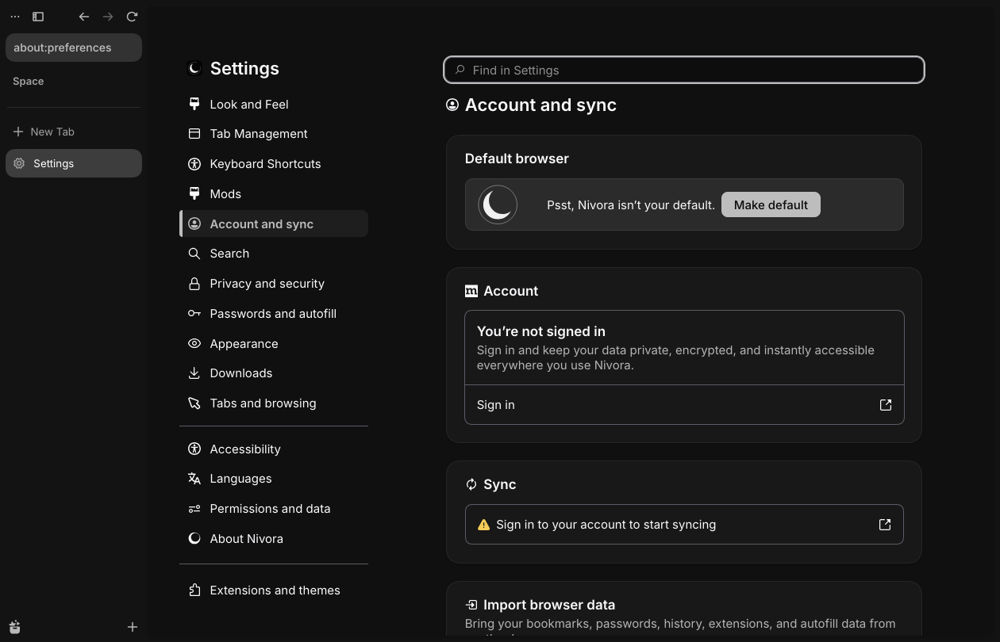
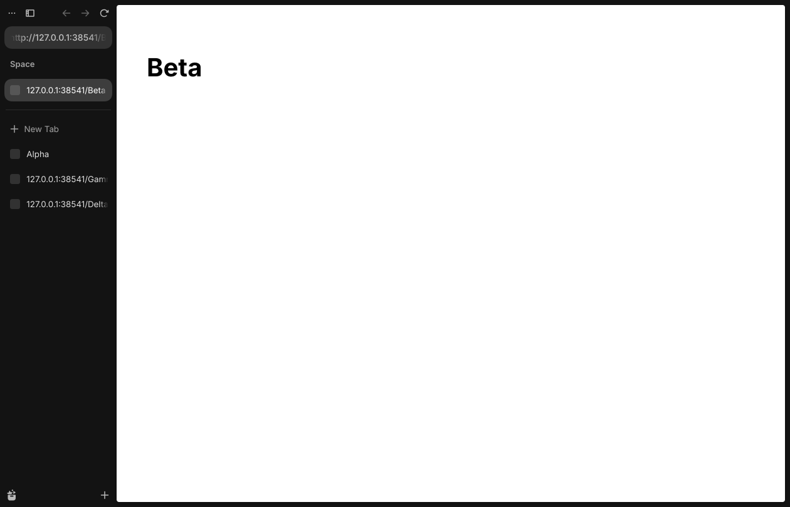

<!--
   - This Source Code Form is subject to the terms of the Mozilla Public
   - License, v. 2.0. If a copy of the MPL was not distributed with this
   - file, You can obtain one at http://mozilla.org/MPL/2.0/.
   -->

<p align="center"></p>

# Nivora Browser

_Less noise. More control._

Nivora is a desktop web browser for people who value focus, privacy and control over their
working environment. It is a derivative of [Zen Browser](https://github.com/zen-browser/desktop),
which is itself a derivative of Mozilla Firefox. Nivora adds its own visual identity
(**Obsidian Eclipse**: monochrome, dark, compact) and, in later phases, its own productivity
features, while keeping the rendering engine and most of the interface of its parents.

> **Status: pre-alpha (`0.1.0a1`). Nothing is released.**
> The browser **builds and runs** in a Linux container (X11): it starts, loads pages, keeps its own
> profile directory, resolves no Zen-operated host on a first start, and shows the Obsidian Eclipse
> palette. Nivora's own browser tests and a subset of Zen's pass. A package for Arch Linux and
> Ryoku Arch can be built by CI and installed by following [the guide below](#install-on-arch-linux-and-ryoku-arch);
> **the owner reports that it installs and runs on Ryoku Arch** (no details recorded); no other system has
> been tried. Not done: a release (LTO/PGO)
> build, measurements on a GPU, an independent security review.
> [docs/ROADMAP.md](docs/ROADMAP.md) lists every item with its state and
> [docs/TESTING.md](docs/TESTING.md) exactly what was and was not run.

## What Nivora is built on

| Layer | Project | Version used | License |
|---|---|---|---|
| Rendering engine, platform | [Mozilla Firefox](https://www.mozilla.org/firefox/) (Gecko) | 158.0.1 | MPL-2.0 and others |
| Interface and features | [Zen Browser](https://github.com/zen-browser/desktop) | 1.23.4b (`stable`, `541ee55`) | MPL-2.0 |
| Customization layer | Nivora (this repository) | 0.1.0a1 | MPL-2.0 for modified upstream files |

Nivora is **not** an official Mozilla or Zen product and is not endorsed by either project.
It does not use their logos or branding, and it does not talk to services operated by the Zen
project (update server, share service, donation prompts, welcome pages). See
[docs/UPSTREAM.md](docs/UPSTREAM.md) and
[ADR 0004](docs/decisions/0004-upstream-service-isolation.md).

## What it looks like

| | |
|---|---|
|  |  |
|  |  |

Development build, X11 under Xvfb, taken by `tools/nivora/screenshots.py`.

## Install on Arch Linux and Ryoku Arch

This is a **pre-alpha test build**, made to be tried and reported on, not to replace your daily browser.
It is a development build: no LTO or PGO, so it is slower than a release would be, and a few libraries that
Firefox normally runs in a WebAssembly sandbox run natively, so do not use it for anything sensitive
([docs/SECURITY.md](docs/SECURITY.md) section 5). It keeps its own
profile in `~/.config/nivora` and its cache in `~/.cache/nivora`; it never reads `~/.zen`, `~/.mozilla`
or `~/.config/zen`. It has no auto-updater: you update by installing a newer package.

**What has and has not been tested.** Verified in an Ubuntu 24.04 container: the package builds with a
real `makepkg`, installs, starts under X11 and under a headless Wayland compositor (sway), loads a page,
and creates only `~/.config/nivora`; the dependency list is checked against the libraries the build links
([`check_arch_deps.py`](tools/nivora/check_arch_deps.py)); the desktop entry and AppStream file validate.
**On a real system:** the owner installed the package with `pacman -U` on Ryoku Arch (2026-10-27) and reports
that it works; the session type, GPU and what was exercised were not recorded. **Not tested: any other real
Arch or Ryoku Arch system, other GPUs, Hyprland, KDE, GNOME.** Section 6 says what to send back, and
a report that says which of these you used is worth more than "it works".

Ryoku Arch is Arch Linux underneath, and Nivora has no Ryoku-specific code, so everything below is plain
Arch. Anything that behaves differently on Ryoku is exactly what is worth reporting.

**In short**, once you have the package from GitHub Actions (section 2, option A) unzipped in `~/nivora-pkg`:

```sh
cd "$(dirname "$(find ~/nivora-pkg -name '*.pkg.tar.zst' | head -1)")"     # the `out` directory of the zip
sha256sum -c SHA256SUMS
sudo pacman -U ./nivora-browser-bin-0.1.0a1-1-x86_64.pkg.tar.zst
P=$(mktemp -d); nivora --no-remote --profile "$P"; rm -rf "$P"      # first start with a throw-away profile
```

### 1. What you need

- An x86_64 Arch Linux or Ryoku Arch system, up to date (`sudo pacman -Syu` first; the build needs glibc 2.38 or newer).
- About 125 MB to download and 320 MB on disk once installed; 2 GB of free RAM to run it.
- A GitHub account that can read this repository (for option A), or about 30 GB of free disk and
  two hours (for option B).
- Sound needs a PulseAudio-compatible server: `pipewire-pulse` on a current Arch, or `pulseaudio`.

### 2. Get the package

**Option A, no compiling (recommended): download what GitHub Actions built.**
The workflow [Build Linux package](https://github.com/AdriLabTech/nivoraBrowser/actions/workflows/nivora-build-linux.yml)
builds the browser from this repository and keeps the result for 14 days as the artifact `nivora-arch-package`.

1. Open the workflow page above and click the latest run with a green check. If there is none, or it is
   older than 14 days, click **Run workflow** (branch `ccr-182bc877-hru910`) and wait about two hours.
2. At the bottom of the run page, under **Artifacts**, download `nivora-arch-package` (a zip) and unzip it:
   ```sh
   sudo pacman -S --needed unzip
   mkdir -p ~/nivora-pkg && cd ~/nivora-pkg
   unzip ~/Downloads/nivora-arch-package.zip
   find . -type f    # out/nivora-browser-bin-0.1.0a1-1-x86_64.pkg.tar.zst, out/PKGBUILD, out/SHA256SUMS, smoke/...
   ```
   With the GitHub CLI (`sudo pacman -S github-cli`, then `gh auth login`) it is one command:
   ```sh
   cd ~/nivora-pkg
   gh run download -R AdriLabTech/nivoraBrowser -n nivora-arch-package \
     "$(gh run list -R AdriLabTech/nivoraBrowser -w nivora-build-linux.yml -s success -L 1 --json databaseId -q '.[0].databaseId')"
   ```

**Option B: build it yourself, inside an Ubuntu 24.04 container.** This is the same procedure the
workflow runs, and it leaves your Arch system untouched except for one directory (the container's home):
the toolchain Firefox 158 needs is much easier to get on Ubuntu than on a rolling Arch. It has **not been
run on Arch**; the script was run on Ubuntu 24.04, where each of its steps is the one documented in
[docs/BUILDING.md](docs/BUILDING.md). You need about 30 GB of free disk and about two hours.

```sh
sudo pacman -S --needed distrobox podman
distrobox create --name nivora-build --image ubuntu:24.04 --home ~/nivora-build-home
distrobox enter nivora-build
```

You are now inside the container, in its own home directory (on your Arch system it is
`~/nivora-build-home`, so nothing lands in your real home). Inside it:

```sh
sudo apt-get update && sudo apt-get install -y git ca-certificates
git clone https://github.com/AdriLabTech/nivoraBrowser.git && cd nivoraBrowser
tools/nivora/build_linux.sh --apt --bootstrap      # about two hours
exit
```

The script installs the system packages with `apt`, downloads Node 22, Rust and `cbindgen` into the
checkout (checksums verified), fetches the Firefox source, builds, packages, and leaves the tarballs
and a `PKGBUILD` with real checksums in `out/`. Back on Arch, build and install the package from them
(there is no compiling in this step, it only repackages the tarball):

```sh
sudo pacman -S --needed base-devel
cd ~/nivora-build-home/nivoraBrowser/out && makepkg -si
```

When you are done, `distrobox rm nivora-build` and `rm -rf ~/nivora-build-home` remove everything
the build created.

### 3. Check and install

If you downloaded the artifact (option A), check the files first, then let `pacman` install the package;
it will list the libraries it needs (`gtk3`, `alsa-lib`, `libpulse`, ...) and ask before installing them:

```sh
cd "$(dirname "$(find ~/nivora-pkg -name '*.pkg.tar.zst' | head -1)")"     # the `out` directory of the zip
sha256sum -c SHA256SUMS                           # every line must say OK
sudo pacman -U ./nivora-browser-bin-0.1.0a1-1-x86_64.pkg.tar.zst
```

(Option B ended with `makepkg -si`, which already installed it.) Then confirm what was installed:

```sh
pacman -Qi nivora-browser-bin          # name, version 0.1.0a1-1, installed size about 317 MiB
pacman -Ql nivora-browser-bin | grep -v '/opt/nivora/'     # launcher, icons, metainfo, licenses
command -v nivora && nivora --version  # /usr/bin/nivora -> /opt/nivora/nivora
```

The package writes only under `/opt/nivora` and `/usr`. `makepkg` and `pacman` also work on the
`PKGBUILD` in the artifact if you prefer to read it first: [`packaging/arch/PKGBUILD`](packaging/arch/PKGBUILD).

### 4. First start

Start with a **throw-away profile**, so that all the browser's data (history, cookies, settings) goes into a
temporary directory that you delete afterwards. Only two empty folders, `~/.config/nivora` and
`~/.cache/nivora`, are still created (checked):

```sh
P=$(mktemp -d); nivora --no-remote --profile "$P"; rm -rf "$P"
```

Run from a terminal, it prints Firefox's usual console messages (D-Bus and GPU lines are normal).
You should see a dark, monochrome window with a vertical tab sidebar; the window assembles itself in
about a second. Then close it and start it normally, from the application menu (**Nivora Browser**) or
with `nivora`. The real profile is created at `~/.config/nivora`.

Wayland or X11: Firefox chooses from the session. To see which one is in use, open `about:support` and
read **Window Protocol**. To force one: `MOZ_ENABLE_WAYLAND=1 nivora` or `MOZ_ENABLE_WAYLAND=0 nivora`
(the second runs through XWayland). The window class (X11) and application id (Wayland) are `nivora`;
use that in window rules (on Hyprland, `hyprctl clients` shows it; on sway, `swaymsg -t get_tree`).

### 5. What to try

| Try | You should see |
|---|---|
| Press **Ctrl+L**, then type `nivora` | The command palette drops in with a springy motion and blur; its rows arrive one after another. The commands *Export / Import / Reset Nivora Settings* and *Toggle Animations* are in the list |
| Use **Down** / **Up** in the palette | A highlight bar glides from row to row |
| Run **Toggle Animations** from the palette | All of Nivora's motion stops at once (and returns when you run it again) |
| Open and close a few tabs (**Ctrl+T**, **Ctrl+W**) | New tabs spring into the sidebar; closed ones step aside and the others close the gap |
| Open `about:preferences` and click different categories | Each category assembles card by card |
| Open `about:policies` | `DisableAppUpdate` is `true`: there is no in-app updating |
| Play a video; play a sound; save a file; open a link from another application | Video and sound work, the file dialog appears, links open in a new tab. (H.264 may need `ffmpeg`; file dialogs through portals need `xdg-desktop-portal`) |
| Check that Zen's and Firefox's own profiles are untouched | `ls -la ~/.zen ~/.mozilla` shows no change in modification times caused by Nivora |
| Compact mode, spaces, split view, Glance | They work as in Zen. They were exercised by Zen's own test groups in a container, not by hand on a desktop |

Make it your default browser only if you want to (it is reversible):

```sh
xdg-settings get default-web-browser                  # write this value down
xdg-settings set default-web-browser nivora.desktop
xdg-settings set default-web-browser <the value you wrote down>      # to go back
```

**What it contacts on a first start.** No host operated by the Zen project. It does contact Firefox's usual
services (Mozilla's remote settings and update service for media components, Google for the default
search engine and the Widevine download, Cisco's OpenH264 download). Each is listed, with the setting that
turns it off, in [docs/PRIVACY.md](docs/PRIVACY.md) section 4. Whether to ship some of those off by default
is a product decision that has not been made.

### 6. Tell us what happened

Open an issue at <https://github.com/AdriLabTech/nivoraBrowser/issues> with:

```sh
nivora --version
pacman -Qi nivora-browser-bin | head -5
echo "$XDG_SESSION_TYPE $XDG_CURRENT_DESKTOP"
lspci -k | grep -A3 -E 'VGA|3D'
```

plus the output of `about:support` (**Copy text to clipboard**) and, for a crash or a blank window, the
text the browser printed when started from a terminal. Say what you expected and what you saw, and whether
it happened on Wayland, X11, or both.

### 7. Update, roll back, remove

- **Update:** there is no updater. Download or build a newer package and `sudo pacman -U` it. Keep the old
  `.pkg.tar.zst`: `sudo pacman -U old-package.pkg.tar.zst` is the rollback.
- **Remove the program:** `sudo pacman -Rns nivora-browser-bin`. Your profile and cache stay.
- **Remove your data too:** `rm -rf ~/.config/nivora ~/.cache/nivora`. Back up `~/.config/nivora` first if
  you want to keep bookmarks or settings; **Export Nivora Settings** in the palette saves the managed
  settings to a file (it never contains passwords or cookies).

### 8. If something goes wrong

| Symptom | What to do |
|---|---|
| `error while loading shared libraries: libfoo.so.N` | `pacman -F libfoo.so.N` names the package; install it and report the library, because the dependency list should have covered it |
| Blank or black window on Wayland, often with the proprietary NVIDIA driver | Try `MOZ_ENABLE_WAYLAND=0 nivora`; if that works, report your GPU and driver. You can also turn off hardware acceleration in the browser settings (search for it) |
| No sound | Install `pipewire-pulse` (or `pulseaudio`) and check `pactl info` |
| Some video does not play | `sudo pacman -S ffmpeg` (H.264 and AAC are not bundled); DRM video (Widevine) is downloaded by the browser on first use and is untested |
| A warning about the content sandbox | Unprivileged user namespaces must be enabled (`sysctl kernel.unprivileged_userns_clone`; kernels such as `linux-hardened` turn them off). Do not turn the sandbox off to silence the warning |
| Wrong or missing fonts | Install `ttf-dejavu`, `noto-fonts`, `noto-fonts-cjk`, `noto-fonts-emoji` |
| File dialogs do not follow your desktop's | `sudo pacman -S xdg-desktop-portal` plus the portal for your desktop; try `GTK_USE_PORTAL=1 nivora` |
| It starts slowly or feels slow | Expected of a development build without LTO and PGO. Report numbers only if you have a comparison |
| Another browser starts instead when you click a link | `xdg-settings get default-web-browser` (see section 5) |

## What is in this repository

- The full Zen source tree, imported unmodified as the repository's **first commit**. Every later
  commit is a Nivora change, so `git diff $(git rev-list --max-parents=0 HEAD)..HEAD` is always
  the exact list of differences from upstream.
- `src/nivora/`, `prefs/nivora/`, `tools/nivora/`: Nivora's own code, preferences and tooling,
  kept apart from inherited code wherever the architecture allows.
- `packaging/`, `licenses/`: Arch Linux packaging files and third-party license texts.
- `docs/`: architecture, decisions, build and test procedures, security, privacy, upstream
  tracking, distribution and maintenance.

## What Nivora adds

- **Obsidian Eclipse:** a monochrome dark identity; palette checked against WCAG; original icon set
  and logo ([docs/DESIGN_SYSTEM.md](docs/DESIGN_SYSTEM.md)).
- **Motion:** one motion language (generated spring curves, cascades, a gliding highlight in the
  command palette, tabs that spring in and step aside, settings panes that assemble themselves),
  switchable as a whole ([docs/ANIMATIONS.md](docs/ANIMATIONS.md)).
- **Commands:** a checked command registry feeding Zen's palette: new tab, history, downloads,
  search open tabs, close duplicate tabs (asks first), toggle animations, export / import / reset settings
  ([docs/PRODUCTIVITY.md](docs/PRODUCTIVITY.md)).
- **Central settings:** 26 managed preferences with validated, versioned export and import that
  never contain secrets.
- **Independence from Zen's services:** no update host, share service, mods injection or
  welcome pages of the Zen project; its own profile directory
  ([docs/SECURITY.md](docs/SECURITY.md)).

## Building and running

Nivora is built with Zen's tooling ([surfer](https://github.com/zen-browser/surfer)) on top of the
Firefox source. A build needs roughly 30 GB of free disk, 8 GB of RAM and several hours on four
cores. The exact, verified procedure is in [docs/BUILDING.md](docs/BUILDING.md).

The whole procedure, from a fresh checkout to a package for Arch, is one script that was run on
Ubuntu 24.04 (and is what the CI workflow runs):

```sh
tools/nivora/build_linux.sh --apt --bootstrap   # Debian/Ubuntu; see --help and the Arch guide above
```

By hand, with Zen's tooling:

```sh
npm ci
npm run download        # Firefox 158.0.1 source (or see BUILDING.md for the GitHub mirror)
npm run import          # apply Zen's patches and Nivora's files
npm run build
npm start
```

## Tests

```sh
python3 -I -m unittest discover -s tools/nivora/tests   # Nivora checks, seconds
python3 -I tools/nivora/check_contrast.py --list        # palette contrast report
node --test tools/nivora/js-tests/*.test.mjs            # command registry and settings
```

With a finished build: `cd engine && ./mach test nivora/tests/browser` (Nivora's browser tests),
`npm test` (Zen's), `tools/nivora/smoke.py`, `tools/nivora/check_profile.py` (settings persist; an existing Zen or
Firefox profile is left alone), `tools/nivora/net_audit.py`. What has and has not been
run is tracked honestly in [docs/TESTING.md](docs/TESTING.md).

## Known limitations

- No Nivora release exists, and no update service: the in-app updater is inert by design until
  the Stable phase defines a distribution channel ([docs/SECURITY.md](docs/SECURITY.md)).
- Wordmarks are text placeholders. The palette, in-content pages, icons and the main artwork are
  restyled; tab states, menus, the downloads panel, typography and the new tab page have not been
  reviewed ([docs/DESIGN_SYSTEM.md](docs/DESIGN_SYSTEM.md)).
- Zen features that depend on Zen-operated services (sharing spaces, the mods marketplace) are
  disabled or point nowhere. The share entry points hide themselves and the donate button and mods
  link are hidden by a preference; the About dialog still links to Zen and Firefox as attribution.
- Linux is the only platform being worked on. Windows and macOS packaging files are inherited and
  untouched. X11 (Xvfb) and Wayland (headless sway) sessions in a container have been used; real
  desktops, GPUs and other Arch systems are untested; Ryoku Arch is reported working by the owner without
  details ([docs/LINUX.md](docs/LINUX.md)).
- Several third-party assets inherited from Zen need a license review before a public release
  ([docs/LICENSES.md](docs/LICENSES.md)).

## License

Nivora is distributed under the [Mozilla Public License 2.0](LICENSE), like the projects it derives
from. Files inherited from Zen and Firefox keep their original notices. Third-party attributions
are tracked in [docs/UPSTREAM.md](docs/UPSTREAM.md).
